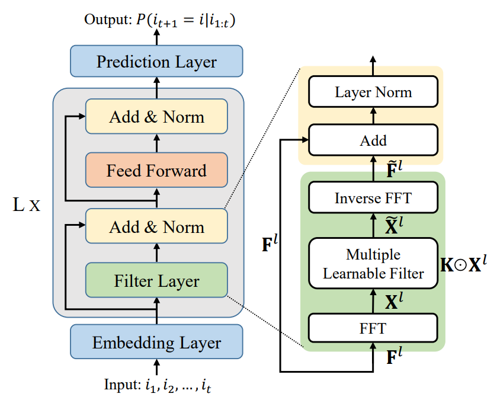

# FMLP-Rec — командный проект по рекомендательным системам

Форк официального репозитория [RUCAIBox/FMLP-Rec](https://github.com/RUCAIBox/FMLP-Rec)
(статья: https://arxiv.org/abs/2202.13556). Оригинальное описание авторов — ниже, в разделе
«Original README».

## Как запустить

### Google Colab (GPU)

Среда выполнения → Сменить среду выполнения → GPU. Затем в ячейках:

```bash
!git clone https://github.com/Sap-Artem/FMLP-Rec_project.git
%cd FMLP-Rec_project
!python scripts/get_ml1m.py          # скачать и подготовить MovieLens-1M (~1 мин)
!python scripts/data_stats.py Beauty ML-1M
```

PyTorch, numpy, scipy и tqdm в Colab уже стоят.

### Локально

```bash
git clone https://github.com/Sap-Artem/FMLP-Rec_project.git
cd FMLP-Rec_project
pip install -r requirements.txt
python scripts/get_ml1m.py
```

**GPU на Windows.** `pip install torch` на Windows ставит версию только для CPU. Для видеокарты NVIDIA
замените её сборкой с CUDA — точную команду выдаёт https://pytorch.org/get-started/locally/
(Stable → Windows → Pip → CUDA), например:

```bash
pip uninstall -y torch
pip install torch --index-url https://download.pytorch.org/whl/cu126
python -c "import torch; print(torch.cuda.is_available(), torch.cuda.get_device_name(0))"
```

Должно вывести `True` и название видеокарты. Без GPU добавляйте к командам `--no_cuda`.

**Если `get_ml1m.py` не может скачать архив** (SSL-ошибка, прокси, антивирус): скачайте
https://files.grouplens.org/datasets/movielens/ml-1m.zip в браузере, положите в `data/ml-1m.zip`
и запустите скрипт ещё раз.

## Проверка, что всё работает

```bash
# 1. Готовая модель авторов на Beauty → HIT@10 ≈ 0.493, NDCG@10 ≈ 0.332
python main.py --data_name=Beauty --do_eval --load_model=FMLPRec-Beauty-4eval

# 2. Одна эпоха обучения на каждом датасете
python main.py --data_name=Beauty --epochs 1
python main.py --data_name=ML-1M --epochs 1

# 3. SASRec — тот же код без фильтров
python main.py --data_name=Beauty --epochs 1 --no_filters
```

Результаты проверки (seed 42). Метрики — запуск на GPU; время — одна эпоха вместе с валидацией
и итоговым тестом.

| Запуск | HIT@10 | NDCG@10 | GPU: RTX 3060 Laptop | CPU |
|---|---|---|---|---|
| Готовая модель, Beauty | 0.4932 | 0.3320 | ~2 с | ~10 с |
| FMLP-Rec, Beauty, 1 эпоха | 0.2999 | 0.1656 | ~15 с | ~4 мин |
| FMLP-Rec, ML-1M, 1 эпоха | 0.6235 | 0.3801 | ~25 с | ~9 мин |
| SASRec, Beauty, 1 эпоха | 0.3170 | 0.1779 | ~17 с | ~7 мин |
| Готовая модель, Beauty, `--full_sort` (CPU) | 0.0563 | 0.0297 | — | ~2 мин |

Готовая модель даёт одинаковые числа на GPU и CPU. Метрики после одной эпохи на CPU немного
отличаются (например, 0.3039 вместо 0.2999 на Beauty): вычисления на GPU и CPU не побитово одинаковы.
Полное обучение — запуск без `--epochs`: до 200 эпох с ранней остановкой, если метрика на валидации
не растёт 10 эпох подряд (`--patience`).

Одна эпоха — только проверка, что код работает, а не результат.

С `--full_sort` правильный объект ранжируется среди всех объектов, а не среди 99 негативов, поэтому
метрики намного ниже — это нормально. В этом режиме выводятся HIT/NDCG@5, @10, @20 (без HIT@1 и MRR).

Логи и чекпоинты пишутся в `output/` (в git не попадают). Полезные параметры: `--hidden_size`,
`--num_hidden_layers`, `--max_seq_length`, `--lr`, `--seed`, `--full_sort`, `--output_dir`;
полный список — `python main.py --help`.

## Данные

Описание, решения по подготовке, статистика и контрольные суммы — в [docs/data.md](docs/data.md).

| Датасет | Пользователи | Объекты | Взаимодействия | Ср. длина истории |
|---|---|---|---|---|
| Beauty | 22 363 | 12 101 | 198 502 | 8.9 |
| ML-1M | 6 040 | 3 416 | 999 611 | 165.5 |

## Структура

```
data/        Beauty.txt, Beauty_sample.txt (в репозитории); ML-1M* — собирается скриптом
scripts/     get_ml1m.py, prepare_ml1m.py, gen_neg_samples.py, data_stats.py
docs/        data.md
output/      готовая модель авторов + логи и чекпоинты запусков
main.py, models.py, modules.py, trainers.py, utils.py, datasets.py — код авторов
```

## Изменения относительно кода авторов

- `trainers.py`, `main.py`: `torch.load(..., map_location=...)` — без этого чекпоинт, сохранённый
  на GPU, не загружался на машине без GPU.
- `utils.py`: добавлен `ML-1M`; любой датасет `data/<имя>.txt` в последовательном формате теперь
  подключается автоматически (нужно для зашумлённых версий данных).
- Добавлены `scripts/`, `docs/`, `requirements.txt`, `.gitignore`.

---

# Original README

# FMLP-Rec
The source code for our WWW 2022 Paper [**"Filter-enhanced MLP is All You Need for Sequential Recommendation"**]()


## Requirements
* Install Python, Pytorch(>=1.8). We use Python 3.7, Pytorch 1.8.
* If you plan to use GPU computation, install CUDA.

## Overview
**FMLP-Rec** stacks multiple **Filter-enhanced Blocks** to produce the representation of sequential user preference for recommendation. The key difference between our approach and SASRec is to replace the multi-head self-attention structure in Transformer with a novel filter structure. You can transform FMLP-Rec to SASRec, by adding `--no_filters` parameter when running code.



## Datasets
We use eight datasets in our paper, all of which have been uploaded to [Google Drive](https://drive.google.com/drive/folders/1omfrWZiYwmj3eFpIpb-8O29wbt4SVGzP?usp=sharing)
 and [Baidu Netdisk](https://pan.baidu.com/s/1we2eJ_Vz9SM33PoRqPNijQ?pwd=kzq2).

The downloaded dataset should be placed in the `data` folder, furthermore, session-based dataset should be placed in a folder named after the dataset.

If you want to use your own dataset, please follow the steps below:
1. Prepare a file with user_ids and each follows 99 negative samples, and name it with `YOUR_DATASTES_sample.txt`. For session-based dataset, only validation set and test set need to be sampled.
2. Place your dataset and sample file in the `data` folder. For session-based dataset, a folder named after the dataset is needed.
3. Add the name of your dataset to the data list in utils.py, according to the data type. 


## Quick-Start
If you have downloaded the source codes, you can train the model just with data_name input.
```
python main.py --data_name=[data_name]
```

If you want to change the parameters, just set the additional command parameters as you need. For example:
```
python main.py --data_name=Beauty --num_hidden_layers=4 --batch_size=512
```

You can also test the model has been saved by command line.
```
python main.py --data_name=Beauty --do_eval --load_model=FMLPRec-Beauty-4eval
```

Additional hyper-parameters can be specified, and detailed information can be accessed by:

```
python main.py --help
```

## Contact
If you have any questions for our paper or codes, please send an email to ishyu@outlook.com.

## Acknowledgement 
Our code is developed based on [S3-Rec](https://github.com/RUCAIBox/CIKM2020-S3Rec)*